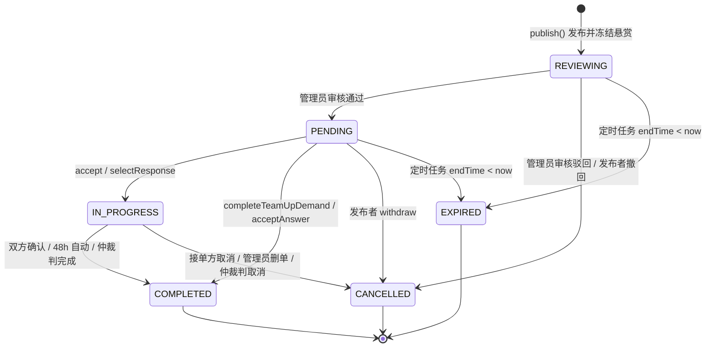
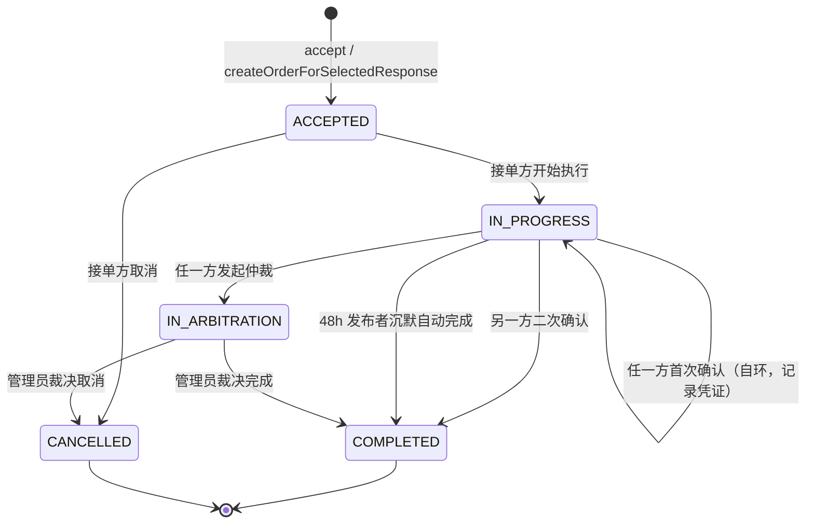
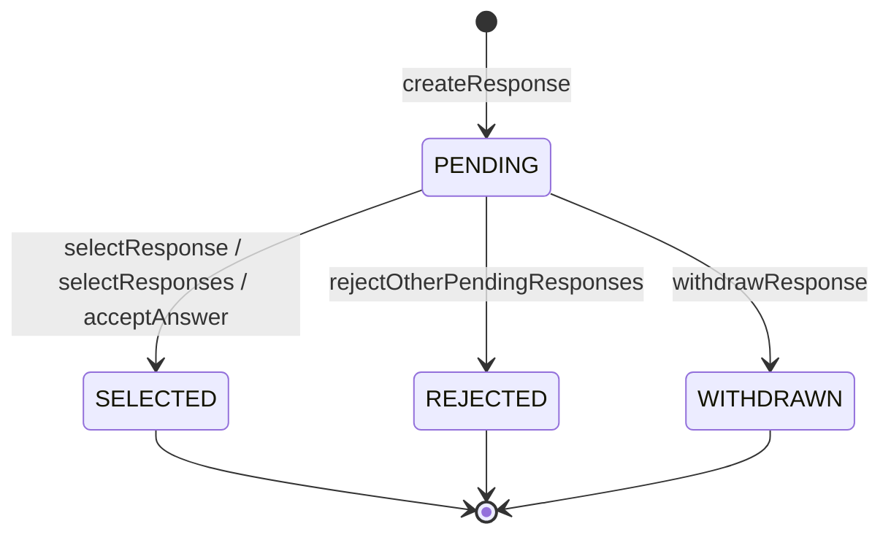

# CampusHub 业务流程与状态机

> 本文档描述需求（Demand）、订单（Order）、响应（Response）三条状态机的**完整转换规则**，
> 以及七类需求各自的业务流程与资金流转路径。
>
> **基线**：`ed7e7e7`（2026-10-30，PR #26 合并后的 main）
> **维护原则**：以代码为唯一事实来源。每条转换均标注代码位置，核对方式见文末[「如何核对本文档」](#8-如何核对本文档)。

---

## 1. 阅读前提：两个正交维度

「需求类型」和「流程形态」在代码里是**两个独立维度**，这是最容易误解的地方。

| 维度 | 枚举 | 位置 |
|---|---|---|
| 分类（用户可见） | `DemandCategory`，7 值 | `backend/src/main/java/com/campushub/backend/demand/domain/DemandCategory.java` |
| 互动模式（决定流程） | `InteractionMode`，4 值 | `backend/src/main/java/com/campushub/backend/demand/domain/InteractionMode.java` |

两者的映射是**硬编码**的，用户不能为固定分类自选模式（`InteractionMode.resolve()`，`InteractionMode.java:33`）：

| 分类 | 中文 | 互动模式 | 是否建 Order |
|---|---|---|---|
| `EXPRESS` | 跑腿代取 | `DIRECT_ACCEPT` | ✅ |
| `ERRAND` | 委托代办 | `DIRECT_ACCEPT` | ✅ |
| `SECOND_HAND` | 二手交易 | `SELECT_ONE` | ✅ |
| `STUDY_TUTORING` | 学习辅导 | `SELECT_ONE` | ✅ |
| `TEAM_UP` | 活动组队 | `SELECT_MANY` | ❌ |
| `HELP` | 互助问答 | `HELP` | ❌ |
| `OTHER` | 其他 | **用户自选** `DIRECT_ACCEPT` / `SELECT_ONE` / `SELECT_MANY`（禁止 `HELP`） | 视选择 |

`OTHER` 的取值约束见 `DemandApplicationServiceImpl.resolveInteractionMode()`（`demand/service/DemandApplicationServiceImpl.java:444`）。

**结论：实际只有 4 条流程，7 个分类是这 4 条流程的入口别名。**

数据库层由五个 CHECK 约束兜底（`backend/src/main/resources/init_schema.sql`）：

```
:101  chk_demand_category     7 值（含 HELP）
:102  chk_demand_status       6 值（含 EXPIRED）
:103  chk_demand_interaction  4 值
:126  chk_order_status        5 值（含 IN_ARBITRATION）
:214  chk_notify_type         17 值
```

---

## 2. `DemandStatus` 状态机

6 个状态：`PENDING` / `REVIEWING` / `IN_PROGRESS` / `COMPLETED` / `CANCELLED` / `EXPIRED`



### 转换明细

| # | 从 → 到 | 触发者 | 入口 | 前置条件 | 副作用 | 代码位置 |
|---|---|---|---|---|---|---|
| 1 | — → `REVIEWING` | 发布者 | `POST /demands` | 余额 ≥ 悬赏；敏感词通过 | 冻结悬赏；通知管理员 | `demand/service/DemandApplicationServiceImpl.java:80`（冻结 `:88`，状态 `:119`） |
| 2 | `REVIEWING` → `PENDING` | 管理员 | `POST /admin/demands/{id}/review` | 状态为 `REVIEWING` 且未过期 | `isApproved=true`；通知发布者 | `admin/service/AdminApplicationServiceImpl.java:188`（状态 `:209`） |
| 3 | `REVIEWING` → `CANCELLED` | 管理员 | 同上 | 需填驳回原因 | `isApproved=false` + `reviewReason`；**解冻**；通知 | `AdminApplicationServiceImpl.java:215` |
| 4 | `REVIEWING`/`PENDING` → `EXPIRED` | **定时任务** | `@Scheduled(fixedRate=300000)` | `endTime < now` | **解冻**；通知 `PENDING`/`SELECTED` 响应者「需求已关闭」 | `demand/service/DemandExpirationScheduler.java:61`（`expireOne` `:77`，状态 `:89`） |
| 5 | `REVIEWING`/`PENDING` → `CANCELLED` | 发布者 | `POST /demands/{id}/withdraw` | 状态 ∈ {`REVIEWING`,`PENDING`} | **解冻**；通知 `PENDING`/`SELECTED` 响应者 | `DemandApplicationServiceImpl.java:304`（状态 `:314`） |
| 6 | `PENDING` → `IN_PROGRESS` | 接单方 | `POST /demands/{id}/accept` | 模式 = `DIRECT_ACCEPT`；状态 = `PENDING`；未过期；非发布者；非 admin；无既有 Order | 创建 `Order=ACCEPTED` | `order/service/OrderApplicationServiceImpl.java:97`（状态 `:141`） |
| 7 | `PENDING` → `IN_PROGRESS` | 发布者 | `POST /demands/{id}/responses/{rid}/select` | 模式 = `SELECT_ONE`；响应为 `PENDING`；响应者非 admin | 创建 `Order=ACCEPTED`；该响应 `SELECTED`；其余 `PENDING`→`REJECTED` | `demand/service/DemandResponseApplicationServiceImpl.java:156` → `OrderApplicationServiceImpl.java:153`（状态 `:201`） |
| 8 | `PENDING` → `COMPLETED` | 发布者 | `POST /demands/{id}/responses/select` | 模式 = `SELECT_MANY`；累计已选 ≥ `targetParticipantCount`；响应者非 admin | **平分结算**；无 Order；其余 `PENDING`→`REJECTED`；通知全员「组队已完成」 | `DemandResponseApplicationServiceImpl.java:186` → `completeTeamUpDemand :326`（状态 `:331`） |
| 9 | `PENDING` → `COMPLETED` | 发布者 | `POST /demands/{id}/responses/{rid}/accept-answer` | 模式 = `HELP`；响应为 `PENDING`；响应者非 admin | **全额结算**；无 Order；通知「回答已采纳」 | `DemandResponseApplicationServiceImpl.java:236`（状态 `:257`） |
| 10 | `IN_PROGRESS` → `COMPLETED` | 双方 | `PUT /orders/{id}` | 双方均已确认 | 转账；通知双方 | `order/service/OrderApplicationServiceImpl.java:447`（`confirmCompletion`，Demand 状态 `:502`，Order 状态 `:488`） |
| 11 | `IN_PROGRESS` → `COMPLETED` | **系统** | `@Scheduled(fixedRate=300000)` | 接单方已确认且**超过 48 小时**发布者仍未确认 | 转账；通知双方；历史记录 `SYSTEM_AUTO_COMPLETED` | `order/service/OrderAutoCompletionScheduler.java:48` → `OrderApplicationServiceImpl.java:402`（`autoCompleteOverdueOrder`，Demand 状态 `:422`，Order 状态 `:418`，48h 判定 `:444`） |
| 12 | `IN_PROGRESS` → `COMPLETED` | 管理员 | `POST /admin/orders/{id}/arbitration/resolve` | `outcome=complete` | 转账 | `AdminApplicationServiceImpl.java:267`（状态 `:285`） |
| 13 | `IN_PROGRESS` → `CANCELLED` | 接单方 | `PUT /orders/{id}` | 当前 = `ACCEPTED`；操作者为接单方 | **解冻**；通知双方 | `OrderApplicationServiceImpl.java:213`（状态 `:237`） |
| 14 | `IN_PROGRESS` → `CANCELLED` | 管理员 | `DELETE /admin/orders/{id}` | 非 `IN_ARBITRATION`、非 `COMPLETED`；原因必填 | **解冻**；物理删订单；通知双方 | `AdminApplicationServiceImpl.java:230`（状态 `:251`） |
| 15 | `IN_PROGRESS` → `CANCELLED` | 管理员 | 仲裁裁决 | `outcome=cancel` | **解冻** | `AdminApplicationServiceImpl.java:289` |

> 全后端共 **15 处** `setStatus(DemandStatus.*)`，上表已全部覆盖。

### 编辑窗口

`Demand.isEditableBy()`（`demand/domain/Demand.java:98`）允许在 `PENDING` / `REVIEWING` / `IN_PROGRESS` 下编辑，
但 `update()`（`DemandApplicationServiceImpl.java:156`）额外拦截：存在 `ACCEPTED`/`IN_PROGRESS`/`IN_ARBITRATION` 订单时锁死交易条款。
因此 `IN_PROGRESS` 实际不可编辑（该状态必然伴随活跃订单）。

悬赏变更按差额冻结/解冻（`update()` 内 `:254` / `:256`）。

已有响应后禁止修改 `category` / `interactionMode`（`update()` 内 `hasResponses` 判断）。

---

## 3. `OrderStatus` 状态机

5 个状态：`ACCEPTED` / `IN_PROGRESS` / `IN_ARBITRATION` / `COMPLETED` / `CANCELLED`

**仅流程 A（`DIRECT_ACCEPT`）和流程 B（`SELECT_ONE`）存在 Order。** 流程 C/D 不建 Order。



### 转换明细

| # | 从 → 到 | 触发者 | 前置条件 | 代码位置 |
|---|---|---|---|---|
| 1 | — → `ACCEPTED` | 接单方 / 发布者 | 见 DemandStatus #6 / #7 | `OrderApplicationServiceImpl.java:127` / `:187` |
| 2 | `ACCEPTED` → `IN_PROGRESS` | 接单方 | 当前 = `ACCEPTED`；操作者为接单方 | `OrderApplicationServiceImpl.java:231`，校验 `validateTransition :597` |
| 3 | `ACCEPTED` → `CANCELLED` | 接单方 | 当前 = `ACCEPTED`；操作者为接单方 | 同上（状态 `:237`） |
| 4 | `IN_PROGRESS` → `IN_PROGRESS`（自环） | 任一方 | 接单方需提交 1-3 张凭证图片 | `confirmCompletion :447` |
| 5 | `IN_PROGRESS` → `COMPLETED` | 另一方 | 双方均已确认 | `confirmCompletion :447`（Order 状态 `:488`，Demand 状态 `:502`） |
| 6 | `IN_PROGRESS` → `COMPLETED` | 系统 | 接单方已确认 + 48h | `autoCompleteOverdueOrder :402`（Order 状态 `:418`，Demand 状态 `:422`） |
| 7 | `IN_PROGRESS` → `IN_ARBITRATION` | 任一方 | 状态 = `IN_PROGRESS`；非发起方重复提交 | `requestArbitration :255`（状态 `:271`）；重复提交校验 `submitArbitrationResponse :292` |
| 8 | `IN_ARBITRATION` → `COMPLETED` | 管理员 | `outcome=complete` | `AdminApplicationServiceImpl.java:283` |
| 9 | `IN_ARBITRATION` → `CANCELLED` | 管理员 | `outcome=cancel` | `AdminApplicationServiceImpl.java:288` |

### 双确认规则

`confirmCompletion()`（`OrderApplicationServiceImpl.java:447`）的关键约束：

- **接单方不能缺席**：发布者先确认会报错 `accepter has not submitted completion proof yet`
- **首次确认不改变 Order 状态**：只置 `proofSubmitted=true` 并写入一条 `IN_PROGRESS → IN_PROGRESS` 的历史记录
- **同一方不能重复确认**：`completion already confirmed by this user`
- **仲裁中冻结一切普通流转**：`validateTransition` 首行即拦截 `IN_ARBITRATION`

---

## 4. `ResponseStatus` 状态机

4 个状态：`PENDING` / `SELECTED` / `REJECTED` / `WITHDRAWN`

**仅流程 B / C / D 存在 Response**（`DIRECT_ACCEPT` 不经过响应层）。



| # | 从 → 到 | 触发者 | 前置条件 | 代码位置 |
|---|---|---|---|---|
| 1 | — → `PENDING` | 任一非 admin 用户 | 模式 ≠ `DIRECT_ACCEPT`；需求已审核通过且 `PENDING`；未过期；非发布者；**非 admin**；`SELECT_ONE`/`SELECT_MANY` 下一人仅一个 active 响应（`HELP` 允许多条） | `DemandResponseApplicationServiceImpl.java:70` |
| 2 | `PENDING` → `SELECTED` | 发布者 | `SELECT_ONE` 单选；响应者非 admin | `:156`（状态 `:175`，admin 校验 `requireNonAdminResponder :419`） |
| 3 | `PENDING` → `SELECTED` | 发布者 | `SELECT_MANY` 批量选；响应者非 admin | `:186`（状态 `:217`） |
| 4 | `PENDING` → `SELECTED` | 发布者 | `HELP` 采纳；响应者非 admin | `:236`（状态 `:250`） |
| 5 | `PENDING` → `REJECTED` | 发布者（间接） | 选中/采纳他人时，其余 `PENDING` 自动驳回并通知 | `rejectOtherPendingResponses :347`（状态 `:354`） |
| 6 | `PENDING` → `WITHDRAWN` | 响应作者 | 状态 = `PENDING` | `:269`（状态 `:282`） |

> **admin 禁止成为响应者**：`createResponse`（`:70`）与三条选中路径均通过 `requireNonAdminResponder()`（`:419`）拦截，
> 覆盖「直接调后端 API」这一绕过前端的路径。

---

## 5. 四条业务流程

### 流程 A：跑腿代取 / 委托代办（`DIRECT_ACCEPT`）

```
发布(冻结) → REVIEWING → 审核通过 → PENDING
                                    │
                    接单方 accept ───┤
                                    ▼
                        Order=ACCEPTED, Demand=IN_PROGRESS
                                    │
                    接单方 开始执行 ──┤
                                    ▼
                              Order=IN_PROGRESS
                                    │
                    接单方 提交凭证+确认 ─┤  (Order 仍 IN_PROGRESS)
                                    ▼
                    发布者 确认 ──────────► Order=COMPLETED
                                    Demand=COMPLETED + 全额转账
                                    │
                                    双方互相评价（submit(orderId)）
```

异常分支：`ACCEPTED` 时可被接单方取消（Demand 同步 `CANCELLED` + 解冻）；
`IN_PROGRESS` 时任一方可发起仲裁；发布者 48 小时不确认则系统自动完成。

### 流程 B：学习辅导 / 二手交易（`SELECT_ONE`）

```
发布(冻结) → REVIEWING → 审核通过 → PENDING
                                    │
                多方提交留言/出价 ─────┼──► Response=PENDING
                                    │
                发布者 select 选定一人 ─┤
                                    ▼
                    Order=ACCEPTED, Demand=IN_PROGRESS
                    该 Response=SELECTED
                    其余 PENDING → REJECTED（逐个通知）
                                    │
                                    └──► 之后与流程 A 完全相同
```

### 流程 C：活动组队（`SELECT_MANY`）

```
发布(冻结, targetParticipantCount 1~100) → REVIEWING → 审核通过 → PENDING
                                                                    │
                                    多方报名（一人一个 active Response）──► PENDING
                                                                    │
                                    发布者分批选人 ◄─────────────────┘
                                          │
                                          ├─ 未满员：选中的响应标 SELECTED 并通知本人，
                                          │          其余响应保持 PENDING 供后续选择，
                                          │          Demand 保持 PENDING，可继续选人，
                                          │          也可整体撤回（悬赏解冻）
                                          │
                                          └─ 累计达到 targetParticipantCount：
                                                 Demand=COMPLETED（跳过 IN_PROGRESS）
                                                 悬赏按人数平分（余数给最后一人）
                                                 通知全员「组队已完成」
                                                 其余 PENDING→REJECTED
                                                      │
                                                      双向评价（submitForResponse(responseId)）
```

### 流程 D：互助问答（`HELP`）

```
发布(冻结) → REVIEWING → 审核通过 → PENDING
                                    │
            多人提交回答（允许同一用户多条）──► Response=PENDING
                                    │
            发布者 acceptAnswer 采纳一条 ──┤
                                    ▼
                    该 Response=SELECTED
                    Demand=COMPLETED（跳过 IN_PROGRESS）
                    悬赏全额结算给被采纳者
                    其余 PENDING → REJECTED（通知）
                                    │
                                    ✗ 无评价（HELP 不评价）
```

---

## 6. 资金流转

悬赏金的四类操作及触发点：

| 操作 | 实现 | 触发场景 |
|---|---|---|
| 冻结 | `DemandApplicationServiceImpl.freezeBalance()` `:474` | 发布需求（`:88`）、修改悬赏差额（`:254`） |
| 解冻 | `DemandApplicationServiceImpl.unfreezeBalanceForDemand()` `:337`；公开入口 `unfreezePublisherBalance()` `:289` | 管理员驳回、发布者撤回、接单方取消、管理员删单、仲裁判取消、需求过期 |
| 全额转移 | `RewardSettlementServiceImpl.settleToAccepter()` `:24` | 流程 A/B 订单完成、流程 D 采纳回答 |
| 平分转移 | `RewardSettlementServiceImpl.settleToMultipleAccepters()` `:40` | 流程 C 组队满员（余数由最后一人承担，保证总和等于总悬赏） |

完整链路：**发布时冻结 → 完成时转移 → 取消/撤回/驳回/过期时解冻**，全程无第三方担保。

---

## 7. 设计边界

以下几条是代码的有意设计，但容易与流程 A/B 混淆，单列说明。

### 7.1 `SELECT_MANY` 与 `HELP` 不创建 Order

这两种模式没有 Order 实体，因此不经过凭证提交、双方确认、48 小时自动完成与仲裁链路，
由 `Demand` 与 `DemandResponse` 两个实体承载全部状态。

| 能力 | 流程 A/B（有 Order） | 流程 C/D（无 Order） |
|---|---|---|
| 凭证提交 | ✅ 1-3 张私密图片 | ❌ |
| 双方确认完成 | ✅ 双确认 | ❌ 无确认环节 |
| 48h 超时自动完成 | ✅ | ❌ |
| 仲裁 | ✅ 管理员裁决 | ❌ |
| 取消 / 退款 | ✅ 接单方可取消 | 见下 |

两者的结算时机不同：

- **`SELECT_MANY`**：累计选中数达到 `targetParticipantCount` 时需求转为 `COMPLETED`，
  悬赏按选中人数平分（余数由最后一人承担，保证总和等于总悬赏，`RewardSettlementServiceImpl:40`）。
  未达目标人数前需求保持 `PENDING`，悬赏仍处于冻结状态，发布者可撤回需求取回。
- **`HELP`**：发布者采纳某一回答时需求转为 `COMPLETED`，悬赏全额结算给被采纳者（`:262`）。
  此后需求不可撤回。

### 7.2 `DemandStatus.IN_PROGRESS` 对流程 C/D 不可达

只有流程 A/B 能到达 `IN_PROGRESS`。前端对组队/问答需求永远不会显示「进行中」。

### 7.3 `CANCELLED` 语义重载

一个状态承载 5 种业务含义：发布者撤回、接单方取消、管理员驳回、管理员删单、仲裁判取消。
仅「管理员驳回」可通过 `reviewReason` 字段区分，其余 4 种无法从状态本身区分。

### 7.4 公开列表可见性规则

`buildWrapper()`（`MyBatisDemandRepository.java:136`）实际规则：

- 公开可见：`PENDING` 或 `IN_PROGRESS`，且未过期；**或** `COMPLETED`（作为历史记录，不受 `end_time` 限制）
- 自己发布的需求：始终可见（含 `REVIEWING`）
- `CANCELLED` / `EXPIRED`：不出现在任何列表

> 历史文档（`P4-前后端对接修订规范` §9.1）描述为「仅返回 `status = PENDING` 的需求」，与实现不符，以代码为准。

---

## 8. 如何核对本文档

本文档的每条转换都标注了 `file:line`。代码变动后按以下方式核对：

```bash
# 1. 重新采集所有状态写入点，与文中转换明细逐条比对
grep -rn 'setStatus(DemandStatus\.'  backend/src/main/java
grep -rn 'setStatus(OrderStatus\.'    backend/src/main/java
grep -rn 'setStatus(ResponseStatus\.' backend/src/main/java

# 2. 核对枚举值与 DB CHECK 约束是否一致
grep -n 'chk_demand_status\|chk_demand_category\|chk_demand_interaction\|chk_order_status\|chk_notify_type' \
  backend/src/main/resources/init_schema.sql

# 3. 核对分类 → 互动模式映射
sed -n '33,45p' backend/src/main/java/com/campushub/backend/demand/domain/InteractionMode.java
```

**若发现不一致，优先改代码使其符合预期业务，再更新本文档**——不要为了让文档"看起来对"而改文档。

已知测试覆盖（`./mvnw verify`，共 540 个）：

| 测试类 | 数量 | 覆盖 |
|---|---|---|
| `DemandResponseApplicationServiceImplTest` | 73 | 响应流转、四种互动模式、admin 禁为响应者 |
| `OrderApplicationServiceImplTest` | 44 | 订单状态机、双确认、仲裁 |
| `DemandApplicationServiceImplTest` | 10 | 发布、编辑、撤回 |
| `DemandExpirationSchedulerTest` | 8 | 过期流转与资金解冻 |
